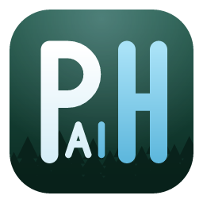

# PersonAIly Hub

**Your local and cloud AI models, in one desktop app.**

Chat, autonomous agents, MCP tools and a VS Code extension, on top of
GGUF models running on your own PC or the cloud providers you already use.

[Download](#download) · [Features](#features) · [Getting started](#getting-started) · [Privacy & security](#privacy--security) · [Contributing](CONTRIBUTING.md)

---

Today you often need two programs: a chat client for cloud models and a separate
manager for local models. PersonAIly Hub puts both in one place, with the same
chat, the same agents and the same tools whichever model you pick.

## Features

**Local models**
- Run `.gguf` models on your PC through [llama.cpp](https://github.com/ggml-org/llama.cpp),
  which the app downloads and updates for you (CUDA, Vulkan or CPU-only build).
- Search and download models from Hugging Face, with resumable downloads, or import files
  you already have.
- A memory estimate before loading: the model and its KV cache live **either in VRAM or in
  RAM**, never silently split, and you are warned if they don't fit.
- Live VRAM/RAM usage, tokens per second and context fill. KV cache quantized to `q8_0`
  by default.

**Cloud models**
- Anthropic, plus any OpenAI-compatible service (OpenAI, OpenRouter, Groq, Mistral,
  Google AI Studio, …) with your own API key.
- Keys are stored in the Windows Credential Manager, never in plain files.

**Chat**
- Streaming answers you can stop, Markdown with code highlighting and math formulas.
- Attachments (text, PDF, images for vision models) and web search with sources.
- Controlled access to the folders you choose: the model can read, create and edit files there.
- Switch model mid-conversation; full-text search through your history.
- Per-model parameters (temperature, top-p, context length, GPU layers…) and named presets
  you can export and import.

**Agents**
- Create agents, start them on a task and follow every step: messages, tools used, files touched.
- Pause, resume or stop them; run several at once.
- Terminal commands and external tools through [MCP](https://modelcontextprotocol.io),
  always behind your permission rules.

**Integrations**
- A local **OpenAI-compatible API**, so existing tools can use your models.
- A **VS Code extension**: chat in the editor with the open file as context, and proposed
  changes shown as diffs to accept or reject ([details](extensions/vscode/README.md)).

The interface is available in **English** and **Italian**.

## Download

Get the latest version from the [Releases page](https://github.com/ThomasCaputo/personaily-hub/releases):

| File | What it is |
|---|---|
| `PersonAIly-Hub_<version>_x64-setup.exe` | Installer (recommended). No administrator rights needed, adds a Start menu entry and an uninstaller. |
| `PersonAIly-Hub_<version>_x64-portable.exe` | Single executable, nothing to install. |
| `SHA256SUMS.txt` | Checksums to verify the downloads. |

> [!NOTE]
> The executables are not code-signed yet, so Windows SmartScreen may show a warning
> the first time. Choose **More info → Run anyway**, or check the file against
> `SHA256SUMS.txt` first.

### Requirements

- Windows 10 or 11, 64-bit, with [WebView2](https://developer.microsoft.com/microsoft-edge/webview2/)
  (already included in Windows 11).
- For local models: enough RAM or VRAM for the model you choose. An NVIDIA GPU (CUDA)
  or any Vulkan-capable GPU speeds things up, but the CPU build works everywhere.

## Getting started

1. **Local model:** on the **Models** page, install llama.cpp under **Engine**, then get a
   model from **Download a model** (or add a folder with your `.gguf` files under
   **Folders**) and load it.
2. **Cloud model:** on the **Models** page, add a provider under **Cloud providers** and
   paste your API key.
3. Start a **chat**, or create an **agent** and give it a folder and a task.

## Privacy & security

- Everything stays on your PC: conversations, settings and models are stored locally
  (`%APPDATA%\dev.personaily.hub`). Nothing is sent anywhere except to the cloud
  providers you configure and the web pages the model reads for you.
- Models can only act where you allow them: granted folders, confirmation before edits
  and commands, and a log of every action.
- The local API listens on `127.0.0.1` only and requires a token.
- Extra protections are **on by default** and can be turned off in **Settings → Security**:
  - *Data-leak protection:* a model that can see your files asks before opening an address
    that came neither from you nor from a search.
  - *Link confirmation:* shows the real address of a link before opening it in your browser.

To report a vulnerability, see [SECURITY.md](SECURITY.md).

## Status

PersonAIly Hub is at its first public version (**0.1**). Windows is the main platform;
Linux and macOS are planned. Upcoming work is tracked in the [roadmap](docs/roadmap.md).

## Contributing

Bug reports, ideas and pull requests are welcome. [CONTRIBUTING.md](CONTRIBUTING.md)
explains how to build the app from source and run the checks. The design documents in
[`docs/`](docs/) are written in Italian.

## License

PersonAIly Hub is released under the [Apache License 2.0](LICENSE). See also [NOTICE](NOTICE).

It is built with [Tauri](https://tauri.app), [React](https://react.dev) and
[llama.cpp](https://github.com/ggml-org/llama.cpp) (downloaded at runtime, MIT license).
